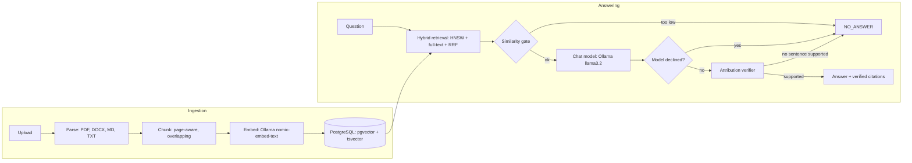

# Lexicon


**Document-search API with cited answers, running entirely on a local LLM.**
Upload PDFs, Word files, Markdown or text, then ask questions. Lexicon answers only from your documents,
cites the exact source of every sentence, and refuses when the documents don't contain the answer.

Spring Boot 4 · Spring AI 2 · Java 21 · PostgreSQL + pgvector · Ollama · Testcontainers

## Why this project

Most RAG demos stop at "it returned something plausible". Lexicon is built around the questions that matter
once you want to trust the output:

- **Are the citations real?** Small models write the right answer with the wrong source number. Lexicon does
  not trust the model's `[n]` markers; it verifies every sentence against the retrieved chunks.
- **Does it know when it doesn't know?** Three independent refusal layers, measured on unanswerable questions
  and a prompt-injection attempt.
- **Is a change an improvement?** A built-in evaluation harness measures retrieval, answer accuracy, citations
  and refusals, and CI can fail the build when quality drops.

## Features

- **Ingestion:** PDF (page-aware), DOCX, Markdown, TXT. Idempotent by SHA-256, with a
  `PROCESSING / READY / FAILED` lifecycle and transactional chunk storage.
- **Hybrid retrieval:** pgvector HNSW (cosine) and PostgreSQL full-text search fused with Reciprocal Rank
  Fusion in a single SQL query; vector-only and keyword-only modes for comparison.
- **Cited answers:** verified citations pointing at document, page and chunk snippet.
- **Streaming:** Server-Sent Events with provisional `token` events and one authoritative `result` event.
- **Evaluation harness:** 50 questions, retrieval and answer metrics, a similarity-gate analysis and a CI quality gate.
- **Production hygiene:** Flyway migrations, RFC 9457 problem+json errors, API-key authentication,
  per-client rate limiting, request IDs in logs, Micrometer/Prometheus metrics, OpenAPI/Swagger UI.
- **Tests:** unit tests plus a Testcontainers integration test over real HTTP against a real pgvector database.

## Architecture



Design decisions are recorded as ADRs in [`docs/adr`](docs/adr):

1. [Own the vector schema; fuse hybrid results in SQL](docs/adr/0001-own-the-vector-schema.md)
2. [Layered grounding; the similarity gate is only a coarse filter](docs/adr/0002-layered-grounding.md)
3. [Verify attribution instead of trusting model citations](docs/adr/0003-verify-attribution.md)
4. [Evaluation relies on evidence strings, not chunk IDs](docs/adr/0004-evidence-based-evaluation.md)
5. [API-key filter and in-process rate limiter instead of Spring Security](docs/adr/0005-lightweight-security.md)

## Quick start

Requirements: Java 21+, Docker, [Ollama](https://ollama.com).

```bash
git clone https://github.com/makrischaralampos/lexicon.git && cd lexicon

docker compose up -d                       # PostgreSQL + pgvector on localhost:5433
ollama pull llama3.2:3b && ollama pull nomic-embed-text

export LEXICON_SECURITY_API_KEYS=$(openssl rand -hex 24)   # fish: set -gx ...
./mvnw spring-boot:run
```

Without `LEXICON_SECURITY_API_KEYS` the API starts unauthenticated and logs a warning. In another terminal:

```bash
KEY=$LEXICON_SECURITY_API_KEYS

# upload (201 for new files, 200 when the identical file already exists)
curl -H "X-Api-Key: $KEY" -F "file=@sample-docs/handbook.txt" localhost:8080/api/v1/documents

# ask
curl -s localhost:8080/api/v1/answers -H "X-Api-Key: $KEY" -H 'Content-Type: application/json' \
  -d '{"question":"How many vacation days do employees get?"}'
```

```json
{
  "status": "ANSWERED",
  "reason": null,
  "answer": "Every full-time employee receives 25 days of paid vacation per calendar year [1].",
  "citations": [
    {
      "index": 1,
      "chunkId": "…",
      "documentId": "…",
      "filename": "handbook.txt",
      "pageNumber": null,
      "snippet": "Orbital Dynamics Employee Handbook Vacation and leave Every full-time employee receives 25 days of paid vacation per calendar year. Unused vacation days can be carried over…"
    }
  ],
  "stats": {
    "chunksRetrieved": 5,
    "topSimilarity": 0.7,
    "retrievalMs": 311,
    "generationMs": 675
  }
}
```

A question the documents cannot answer returns `"status": "NO_ANSWER"` with a `reason`
(`NO_RELEVANT_CONTEXT`, `MODEL_DECLINED` or `UNSUPPORTED_ANSWER`) and no citations.
Interactive docs: <http://localhost:8080/swagger-ui.html>.

## API

| Method       | Path                                       | Purpose                                                                                 |
| ------------ | ------------------------------------------ | --------------------------------------------------------------------------------------- |
| POST         | `/api/v1/documents`                        | Upload and ingest a file (multipart)                                                    |
| GET          | `/api/v1/documents`                        | List documents (paged)                                                                  |
| GET / DELETE | `/api/v1/documents/{id}`                   | Inspect / delete a document and its chunks                                              |
| POST         | `/api/v1/search`                           | Retrieval only: `mode` = `VECTOR`, `KEYWORD` or `HYBRID`, optional `documentIds` filter |
| POST         | `/api/v1/answers`                          | Cited answer or refusal                                                                 |
| POST         | `/api/v1/answers/stream`                   | Same, as Server-Sent Events: `token`, `result`, `error`                                 |
| GET          | `/actuator/health`, `/actuator/prometheus` | Health and metrics                                                                      |

Errors are RFC 9457 `application/problem+json`. Every response carries an `X-Request-Id` header that also
appears in the logs.

## Evaluation

The harness (`eval/questions.yml`, run with the `eval` Spring profile) uses a separate, self-wiping database and
a corpus of 7 documents (39 chunks) with deliberate near-miss distractors, such as similar numbers, ticket
prefixes and opening hours in different documents. There are 50 questions: 42 answerable (direct, paraphrased,
exact-token and multi-fact) and 8 unanswerable, including a prompt-injection attempt.

```bash
./mvnw spring-boot:run -Dspring-boot.run.profiles=eval \
  -Dspring-boot.run.arguments="--lexicon.eval.report-name=my-run"
```

It writes a Markdown report to `eval/reports/` and exits non-zero when the configured thresholds are missed.
All reports below are committed in [`eval/reports`](eval/reports). Model: `llama3.2:3b`, embeddings:
`nomic-embed-text`, on a laptop GPU.

### Retrieval, k = 5 ([attribution.md](eval/reports/attribution.md))

| Mode             | hit@1     | hit@3 | hit@5 | MRR       |
| ---------------- | --------- | ----- | ----- | --------- |
| Vector only      | 85.7%     | 100%  | 100%  | 0.925     |
| Keyword only     | 90.5%     | 97.6% | 100%  | 0.942     |
| **Hybrid (RRF)** | **92.9%** | 100%  | 100%  | **0.964** |

hit@5 is saturated on a corpus this small, so hit@1 and MRR are the informative columns. Hybrid hit@1 moved
between 92.9% and 95.2% across runs of identical retrieval code, which is one question: ties in the full-text
rank are broken by random chunk IDs. Treat retrieval differences of one or two questions as noise.

### Answers

| Metric                                             | Result |
| -------------------------------------------------- | ------ |
| Answer accuracy (42 answerable)                    | 100%   |
| False refusals                                     | 0%     |
| Citation hit rate                                  | 100%   |
| Citation precision                                 | 98.8%  |
| Correct refusals (8 unanswerable, incl. injection) | 100%   |
| Average end-to-end latency                         | 379 ms |

### Experiments that shaped the defaults

| Configuration                                   | Hybrid hit@1 | Hybrid MRR | Vector hit@1 | Answer accuracy |
| ----------------------------------------------- | ------------ | ---------- | ------------ | --------------- |
| 400-char chunks, 80 overlap, no prefixes        | 95.2%        | 0.976      | 85.7%        | 95.2%           |
| **400 / 80 with nomic task prefixes (default)** | 95.2%        | 0.976      | 85.7%        | **100%**        |
| 800 / 120, no prefixes                          | 85.7%        | 0.925      | 71.4%        | 95.2%           |

Larger chunks hurt retrieval, most visibly for exact tokens. The embedding model's documented
`search_query:` / `search_document:` prefixes left retrieval unchanged and fixed two answers.
Reports: [baseline](eval/reports/baseline.md), [prefixes](eval/reports/prefixes.md),
[chunks-800](eval/reports/chunks-800.md).

### The citation problem and its fix

|                    | Model's own `[n]` markers | Verified against the chunks |
| ------------------ | ------------------------- | --------------------------- |
| Citation hit rate  | 64.3%                     | **100%**                    |
| Citation precision | 64.3%                     | **98.8%**                   |
| Answer accuracy    | 100%                      | 100%                        |

The 3B model usually wrote the right answer but pointed `[n]` at the wrong source. Rather than prompt-tune,
`AttributionVerifier` re-derives the citation for every sentence from the retrieved chunks (content-word
coverage, with every number required to appear in the source) and drops sentences no source supports. See
[ADR 3](docs/adr/0003-verify-attribution.md).

### The similarity gate

On this benchmark the lowest top-similarity among answerable questions is 0.528 and the highest among
unanswerable ones is 0.718. The groups overlap, so no cutoff separates them; the gate (0.40) only removes
clearly off-topic queries cheaply. Correct refusals come from the model and verifier layers. A production
histogram (`lexicon_retrieval_top_similarity_percent`) lets you re-check this on real traffic.
See [ADR 2](docs/adr/0002-layered-grounding.md).

## Observability and security

- **Metrics** (Micrometer, `/actuator/prometheus`): answers by status and refusal reason, retrieval and
  generation timers, a similarity histogram, ingestion counts and chunks per document, rate-limit rejections,
  plus the standard HTTP and Spring AI model metrics.
- **Authentication:** `X-Api-Key`, stored only as SHA-256 digests and compared in constant time; keys under
  16 characters are refused at startup.
- **Rate limiting:** token bucket per client, 120 requests/min in general and 10/min on the LLM endpoints,
  with `429` and `Retry-After`.

## Testing and CI

`./mvnw verify` runs 59 tests: unit tests for chunking, query building, attribution verification, answer
grounding, streaming, rate limiting and authentication, and a Testcontainers integration test that boots the
application against a real pgvector database. Ollama is replaced by deterministic fakes, so no model is needed.

GitHub Actions: [`ci.yml`](.github/workflows/ci.yml) runs the build on every push and pull request.
[`eval.yml`](.github/workflows/eval.yml) installs Ollama, runs the full benchmark weekly or on demand, and fails
when quality falls below the thresholds in `application-eval.yml`.

## Configuration

| Setting                                         | Default                                        | Purpose                               |
| ----------------------------------------------- | ---------------------------------------------- | ------------------------------------- |
| `LEXICON_SECURITY_API_KEYS`                     | none (auth off)                                | Comma-separated API keys              |
| `DB_URL`, `DB_USER`, `DB_PASSWORD`              | `localhost:5433/lexicon`, `lexicon`, `lexicon` | PostgreSQL                            |
| `OLLAMA_URL`                                    | `http://localhost:11434`                       | Ollama                                |
| `LEXICON_CHAT_MODEL`                            | `llama3.2:3b`                                  | Chat model                            |
| `LEXICON_EMBEDDING_MODEL`                       | `nomic-embed-text`                             | Embedding model (768 dimensions)      |
| `lexicon.ingestion.chunk-size / chunk-overlap`  | `400` / `80`                                   | Chunking                              |
| `lexicon.retrieval.*`                           | top-k 5, pool 30, RRF k 60                     | Retrieval                             |
| `lexicon.answer.min-similarity` / `min-support` | `0.40` / `0.50`                                | Similarity gate / verifier strictness |
| `lexicon.rate-limit.*`                          | 120 / 10 per minute                            | Rate limits                           |

Changing the embedding model or the prefixes requires re-ingesting your documents, since stored vectors
are model-specific.

## Limitations and next steps

- The benchmark is small and synthetic (7 documents, 50 questions). It is good at catching regressions, not
  at predicting quality on arbitrary corpora.
- The attribution verifier is lexical. It catches wrong figures and unsupported sentences but not negation or
  subtle paraphrase errors; an NLI model or a stronger LLM judge would complement it.
- The LLM-as-judge faithfulness score from a 3B model is unreliable (it reports about 64% even though every
  sentence passes the verifier), so it is informational and never gates CI.
- Full-text search is configured for English; scanned PDFs need OCR; no reranker; the rate limiter is
  in-memory (single instance); the Actuator endpoints are not behind the API key and belong on a separate
  management port in production.
- Next: deterministic tie-breaking in the ranking, a cross-encoder reranker, multilingual full-text
  configuration, a container image with a Helm chart, and an NLI-based verifier.

## Project layout

```
src/main/java/dev/makris/lexicon
  api/            controllers, DTOs, problem+json handling
  answer/         prompting, grounding layers, attribution verifier, streaming
  retrieval/      vector, keyword and hybrid (RRF) search
  ingestion/      parsing, chunking, embedding pipeline
  chunk/ document/  persistence (JdbcClient, no ORM)
  config/         properties, API key + rate limit filters, request IDs, OpenAPI
  observability/  business metrics
  eval/           evaluation harness (profile "eval")
eval/             question set and committed reports
docs/adr/         architecture decision records
```

## License

MIT
